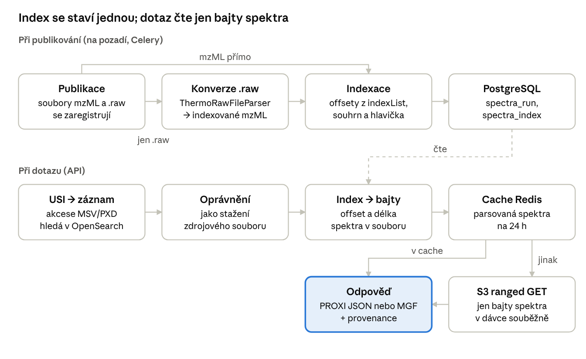

# Přístup k jednotlivým spektrům v repozitáři chemické biologie

Stav k 3. 11. 2026 · Daniel Mikšík

## Proč a co to umí

Repozitář chemické biologie (OARepo 14 / InvenioRDM) nově vydá **jedno konkrétní hmotnostní spektrum** z publikovaného souboru mzML nebo Thermo `.raw`, aniž by se musel stahovat celý soubor (typicky 50–150 MB, tisíce spekter).

Motivační scénář je DreaMS: nástroj si z repozitáře převezme celé záznamy, spočítá embeddingy a hledá podobná spektra. Uživatel pak chce stáhnout jen ta nalezená spektra, i z různých datasetů. K tomu slouží:

- **adresace spektra** standardním identifikátorem USI (HUPO-PSI), shodným s MassIVE,
- **API ve formátu PROXI** (standard ProteomeXchange) pro jedno spektrum i datasety,
- **hromadné stažení** stovek spekter najednou jako JSON nebo MGF,
- **údaje o původu** u každého spektra (přístroj, software, dataset, licence, citace),
- **náhled v prohlížeči** na stránce záznamu (graf spektra, tlačítko „Copy USI“).

Přístup se řídí oprávněními k souborům záznamu: spektrum smí číst, kdo smí stáhnout soubor, ze kterého pochází.

## Adresace spektra: USI

Každé spektrum má Universal Spectrum Identifier (HUPO-PSI USI 1.0), který se dá ocitovat, poslat kolegovi nebo použít v jiném nástroji:

```
mzspec:MSV000083272:peak/20170731_WTcol:scan:3
mzspec:<kolekce>:<msRun>:<scan|index|nativeId>:<hodnota>
```

| Část | U nás |
| --- | --- |
| kolekce | akcese ProteomeXchange/MassIVE (PXD…, MSV…) z identifikátorů záznamu; když ji dataset nemá, ID záznamu (funguje jen v našem repozitáři) |
| msRun | cesta souboru v záznamu bez přípony `.mzML`/`.raw` |
| scan / index / nativeId | číslo scanu, pořadí v souboru (od 0), nebo nativeID z mzML |

Soubory převzaté z MassIVE mají stejnou cestu jako na MassIVE, takže **jedno USI platí v obou repozitářích** (ověřeno, píky bit po bitu shodné). Akceptujeme i varianty, které používá MassIVE: s příponou, bez cesty, nebo s cestou ke kopii GNPS v `ccms_peak/`.

## API

Všechny endpointy vrací JSON a chyby jako PROXI objekt `{code, message}`; 409 znamená, že soubor ještě není zaindexovaný.

| Endpoint | Co vrací |
| --- | --- |
| `GET /api/proxi/v0.1/spectra?usi=…&resultType=compact\|full` | jedno spektrum (PROXI) |
| `POST /api/proxi/v0.1/spectra?format=json\|mgf` | spektra seznamu USI, tělo `{"usis": […]}` (naše rozšíření, max. 1000) |
| `GET /api/proxi/v0.1/datasets?search=&species=&accession=` | datasety (PROXI) |
| `GET /api/proxi/v0.1/datasets/<akcese nebo ID>` | jeden dataset (PROXI) |
| `GET /api/dataset/<id>/files/<klíč>/spectra?ms_level=&page=` | seznam spekter souboru s jejich USI |
| `GET /api/dataset/<id>/files/<klíč>/spectra/scan/<n>` | jedno spektrum podle souboru a scanu |

Jedno spektrum:

```bash
curl 'https://<repo>/api/proxi/v0.1/spectra?resultType=full&usi=mzspec:MSV000083272:peak/20170731_WTcol:scan:3'
```

Více spekter jako MGF:

```bash
curl -X POST -H 'Content-Type: application/json' \
  'https://<repo>/api/proxi/v0.1/spectra?format=mgf' \
  -d '{"usis": ["mzspec:MSV000083272:peak/20170731_WTcol:scan:3", "mzspec:MSV000083275:peak/Nicotiana_CYP719A26/20171023_N01_vector:scan:500"]}'
```

Spektrum, které nejde přečíst (neplatné USI, neexistuje, chybí oprávnění), dávku nezastaví: v JSON má stav `PEAK UNAVAILABLE` a `error: {code, message}`, v MGF je jako komentář `#`. Klient pyteomics umí s naším PROXI pracovat přímo.

## Co putuje se spektrem

Spektrum vyjmuté z repozitáře musí zůstat citovatelné a interpretovatelné. Odpověď `resultType=full` proto nese tři vrstvy:

| Vrstva | Obsah | Zdroj |
| --- | --- | --- |
| spektrum | m/z a intenzity, MS level, RT, prekurzor, náboj, izolační okno, fragmentace a collision energy, polarita | element `<spectrum>` v mzML |
| soubor a přístroj | model přístroje (Q Exactive), ionizace, analyzátory, software s verzí (Xcalibur, ProteoWizard) | hlavička mzML, jako termíny PSI-MS v `attributes` |
| původ (`provenance`) | dataset (akcese, DOI, odkaz, autoři, organismus, licence, hotová citace), soubor (cesta, odkaz, MD5), měření (čas, původní `.raw` se SHA-1, postup zpracování) | metadata záznamu a hlavička mzML |

Objekt `provenance` je naše rozšíření; PROXI ho nedefinuje a klienti ho ignorují.

**MGF** používá klíče spektrálních knihoven GNPS (`PEPMASS`, `CHARGE`, `MSLEVEL`, `SCANS`, `IONMODE`, `SOURCE_INSTRUMENT`, `ORGANISM`, `PI`, `DATACOLLECTOR`, `FILENAME`) a přidává `USI`, `DATASET`, `LICENSE`, `CITATION`. Načte ho pyteomics i matchms (základ DreaMS) včetně metadat.

## Jak to funguje uvnitř

Klíčový trik: indexované mzML má na konci tabulku bajtových offsetů všech spekter. Repozitář ji přečte jednou při publikování a pak už každé spektrum vytáhne z S3 jedním požadavkem na přesný rozsah bajtů.



- **Indexace** běží v Celery po publikování záznamu; do PostgreSQL uloží offset, délku a souhrn každého spektra (MS level, RT, prekurzor, náboj) a hlavičku souboru (přístroj, software, původní raw).
- **Konverze `.raw`** (ThermoRawFileParser 1.4.5 v Dockeru) vytvoří indexované mzML mimo soubory záznamu; dostat se k němu jde jen přes API s oprávněním k původnímu raw souboru.
- **Oprávnění** kontroluje služba souborů InvenioRDM při každém dotazu, takže platí embargo, omezený přístup i odkazy pro sdílení.
- **Cache:** publikované soubory se nemění, takže parsovaná spektra se drží v Redis; dávkový dotaz čte chybějící spektra z S3 souběžně.
- **Podporováno:** indexované mzML bez komprese nebo se zlib a Thermo `.raw`; ostatní soubory dostanou stav `UNSUPPORTED`.

## Testovací data a ověření

Lokální instance obsahuje šest veřejných datasetů z MassIVE ke článku *The biosynthetic origin of psychoactive kavalactones in kava* (Nature Plants 2019, [doi:10.1038/s41477-019-0474-0](https://doi.org/10.1038/s41477-019-0474-0)): 169 souborů mzML, 9,85 GB, **1,24 milionu spekter**, přístroj Q Exactive. Metadata se převzala z MassIVE (název, autoři, druh, klíčová slova, akcese MSV, odkaz na článek).

| Dataset | Organismus | Soubory | Spektra |
| --- | --- | --- | --- |
| MSV000083272 | *Arabidopsis thaliana* | 11 | 70 686 |
| MSV000083274 | 5 druhů *Piper* | 12 | 201 115 |
| MSV000083275 | *Nicotiana benthamiana* | 24 | 164 389 |
| MSV000083276 | *N. benthamiana* | 30 | 179 393 |
| MSV000083277 | *N. benthamiana* | 56 | 379 096 |
| MSV000087906 | *N. benthamiana* (značení d6) | 36 | 242 212 |

Co jsme ověřili:

- **Správnost:** píky jsou bit po bitu shodné s PROXI na MassIVE a s knihovnou pyteomics; konverze `.raw` obsahuje všechny píky MassIVE do 5 ppm.
- **Výkon:** jedno spektrum kolem 50 ms (z cache 27 ms); dávka 300 spekter 3,7 s, z cache 0,85 s; z S3 se na spektrum přenese asi 11 kB.
- **Oprávnění:** soubor s omezeným přístupem vrátí anonymovi 403 na všech endpointech, vlastníkovi data.
- **Interoperabilita:** USI z našeho náhledu otevře stejné spektrum na MassIVE a naopak; MGF načte pyteomics i matchms; 55 unit testů, test prohlížeče bez chyb JS.

## Otevřené otázky a další kroky

- [ ] **Bezpečnostní nedostatek v OARepo nahlásit CESNETu.** V `IndividualWorkflow` je obsah media files dostupný každému, kdo vidí výpis souborů, i u záznamu s omezeným přístupem k souborům. Konvertovaná data proto neukládáme do media files.
- [ ] **Licence povinně.** Kava datasety licenci nemají, takže spektra odcházejí bez podmínek užití.
- [ ] **Organismus i jako NCBI TaxID**, nejen popisek; pole pro druh v modelu navíc bere jen jednu hodnotu.
- [ ] **Termíny PSI-MS pro ID záznamu a odkaz na jeho stránku** neexistují; zatím accession `local`, případně návrh nových termínů HUPO-PSI.
- [ ] **Konverze v produkci:** Celery worker potřebuje Docker (ThermoRawFileParser), nebo jiný konvertor nastavený v `SPECTRA_RAW_CONVERTER`.
- [ ] **Úklid po smazání záznamu:** index a konvertované soubory se zatím odstraňují jen ručně (`invenio spectra reset`).
- [ ] **Webový resolver `/usi/<USI>`**, aby USI fungovalo jako klikací odkaz do náhledu.
- [ ] **Další formáty** (komprese MS-Numpress, `.mzML.gz`, další výrobci raw) a případné zobecnění na jiné typy dat.

## Kde je kód a jak si to spustit

Kód je ve větvi [`feature/spectra-api`](https://github.com/dmiksik/repo_chemical_biology/tree/feature/spectra-api) forku `dmiksik/repo_chemical_biology` (základ: větev `develop` repozitáře `iocbbioinf/repo_chemical_biology`), modul [`common/spectra/`](../common/spectra/) s vlastním [README](../common/spectra/README.md). Pull request do upstreamu zatím není.

| Soubor | Úkol |
| --- | --- |
| `usi.py` | parsování a sestavení USI |
| `mzml_index.py`, `header.py`, `reader.py` | čtení indexu, hlavičky a jednoho spektra z mzML (bez závislosti na Invenio) |
| `tasks.py`, `converter.py`, `components.py` | indexace a konverze po publikování (Celery) |
| `service.py`, `views.py` | oprávnění, cache, dávkové čtení, REST API |
| `proxi.py`, `provenance.py`, `mgf.py` | výstupní formáty |
| `previewer.py` + JS | náhled na stránce záznamu |

Spuštění: lokální instance podle `./run.sh` (OARepo runner, služby v Dockeru), migrace `invenio alembic upgrade`, zaindexování starších záznamů `invenio spectra index --all`. Testovací data stáhne a naimportuje [`scripts/massive_test_data/`](../scripts/massive_test_data/) (`download.py`, `import_records.py`; MassIVE přes HTTPS blokuje hromadné stahování, proto FTP s TLS).
